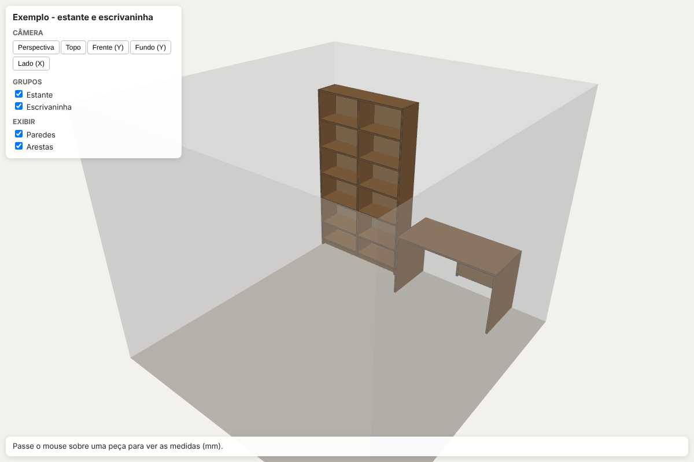
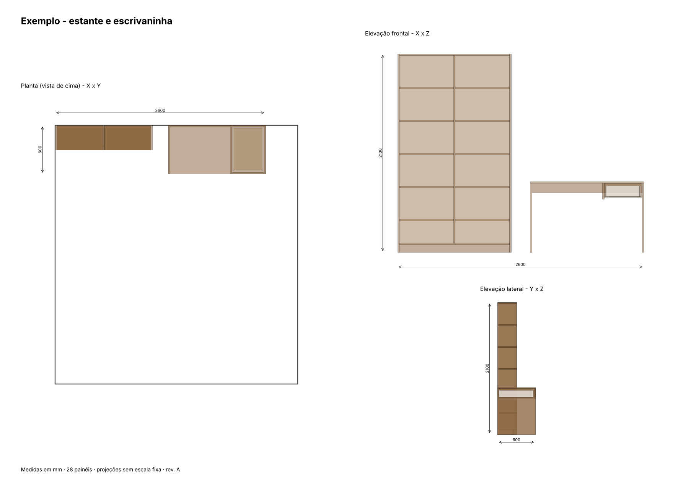
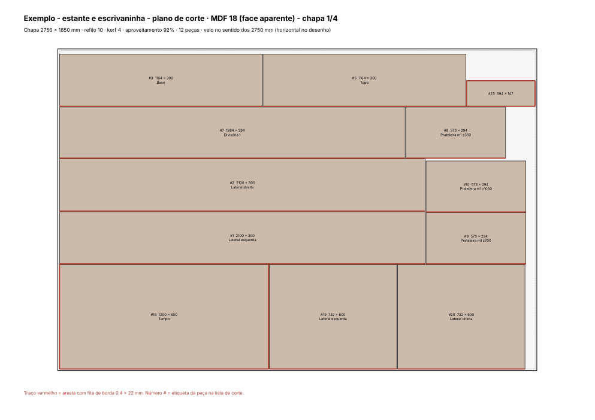

# You Interior Designer

Skill para agentes de IA (Claude Code, Claude.ai e outros compatíveis com Agent Skills) que projeta **móveis planejados em MDF** de ponta a ponta. Os scripts são Python local e geram:

- um **modelo 3D paramétrico**, painel por painel (GLB, OBJ, STL e um visualizador web em three.js);
- **vistas 2D** em A3 (planta, elevação frontal e elevação lateral);
- o **plano de corte** das chapas (rectpack), com fita de borda, respeito ao veio, PDF e CSV para o **Cortecloud**.

*English: an agent skill for designing custom MDF cabinetry. It builds a parametric 3D model, 2D views and an optimized sheet cut list with edge banding.*

| 3D | Vistas 2D | Plano de corte |
|---|---|---|
|  |  |  |

## Instalação

**Com o CLI `skills`** (Claude Code, Cursor, Codex e outros agentes):

```bash
npx skills add steniodsb/you-interior-designer
```

**Como plugin do Claude Code:**

```
/plugin marketplace add steniodsb/you-interior-designer
/plugin install you-interior-designer@you-interior-designer
```

**Manual, no Claude Code:** copie `skills/marcenaria-planejados/` para `~/.claude/skills/` (todos os projetos) ou para `.claude/skills/` (um projeto só).

**No Claude.ai:** compacte a pasta `skills/marcenaria-planejados` num `.zip` e envie em *Settings → Capabilities → Skills*.

## Como usar

Peça ao agente algo como:

> Quero projetar uma estante e uma escrivaninha em MDF para o meu quarto de 3,00 × 3,20. Seguem as fotos e as medidas.

A skill conduz o fluxo nesta ordem:

1. levantamento das medidas;
2. modelo paramétrico;
3. 3D e vistas 2D;
4. ajustes a partir de prints do 3D;
5. plano de corte final.

### Rodar os scripts direto

```bash
cd skills/marcenaria-planejados
python3 -m venv .venv && .venv/bin/pip install -r scripts/requirements.txt
.venv/bin/python exemplo/exemplo_estante.py                    # JSON + 3D
.venv/bin/python scripts/vistas_2d.py exemplo/saida/estante.json
.venv/bin/python scripts/plano_corte.py exemplo/saida/estante.json --chapa 2750x1850 --kerf 4
```

Para ver o 3D, sirva a pasta `exemplo/saida` (`python3 -m http.server`) e abra `estante_3d.html`. O visualizador carrega o three.js do jsdelivr, então precisa de internet.

## Estrutura

```
skills/marcenaria-planejados/
  SKILL.md                    instruções do fluxo para o agente
  scripts/marcenaria.py       classe Projeto: box(), materiais, exportação
  scripts/viewer_template.html
  scripts/vistas_2d.py
  scripts/plano_corte.py
  scripts/requirements.txt
  exemplo/exemplo_estante.py
```

## Padrões e limites

- Chapa padrão de 2750 × 1850, kerf 4 e refilo 10. Tudo isso é configurável por linha de comando.
- Os materiais (nome, cor, espessura, se entra no corte e se pode girar) são configuráveis no `Projeto`.
- As colunas do CSV do Cortecloud podem precisar de ajuste ao modelo de importação da sua conta.
- O projeto é uma ferramenta de apoio. Confira as medidas em obra e valide estrutura e ferragens com o marceneiro antes de cortar.

Licença MIT.
